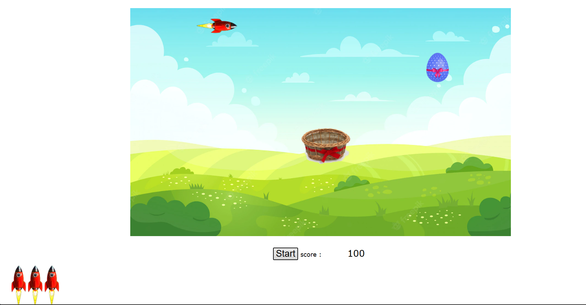

# Egg Catcher Game

A JavaScript game developed as part of an academic project.

The player controls a basket and must catch falling eggs while avoiding rockets. Each collision with a rocket costs one life. The game ends when all three lives are lost.



## Installation

Clone the repository and install the dependencies:

```bash
npm install
```
## Running the Game
Build the project:

```bash
npm run build
```

Start the development server:

```bash
npm run dev-server
```

The game will be available at:

```text
http://localhost:9000
```

## Context
This project was developed as part of an academic JavaScript project.


